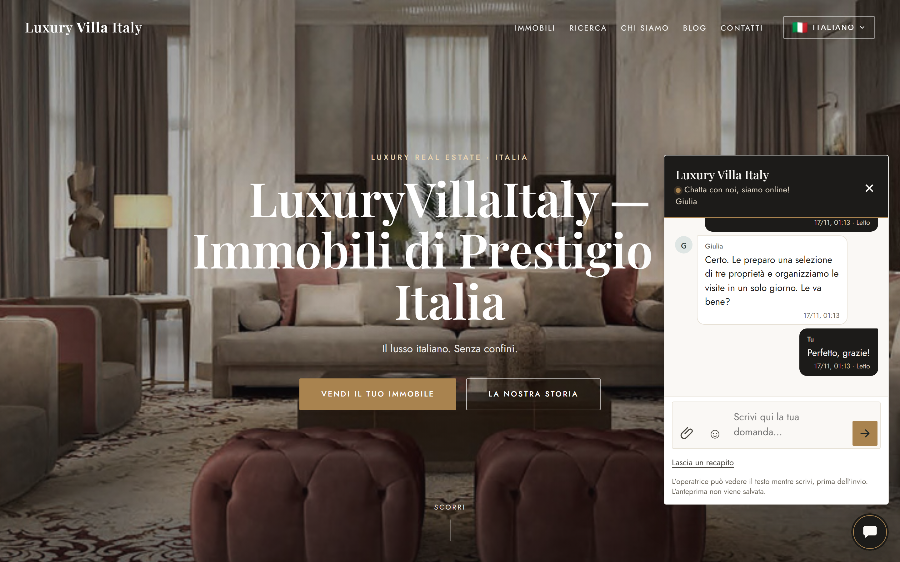
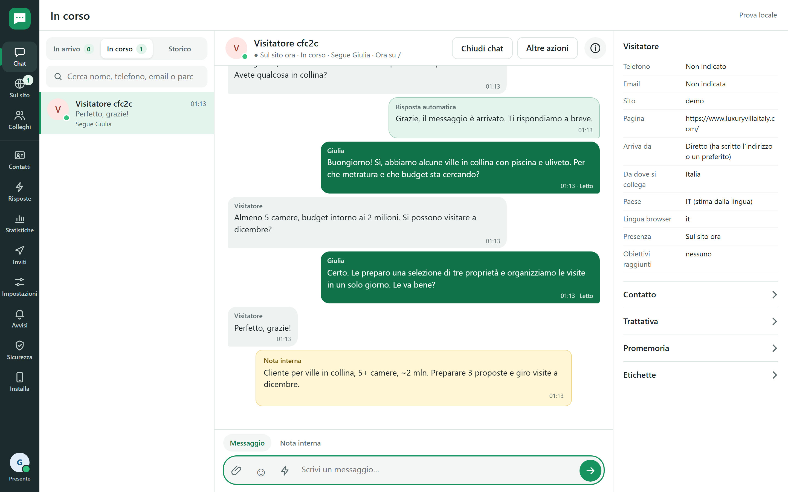
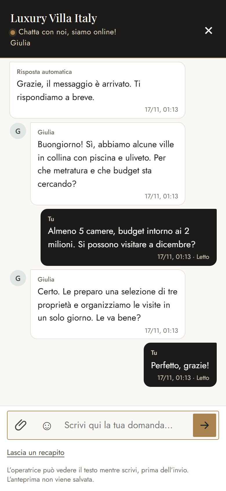
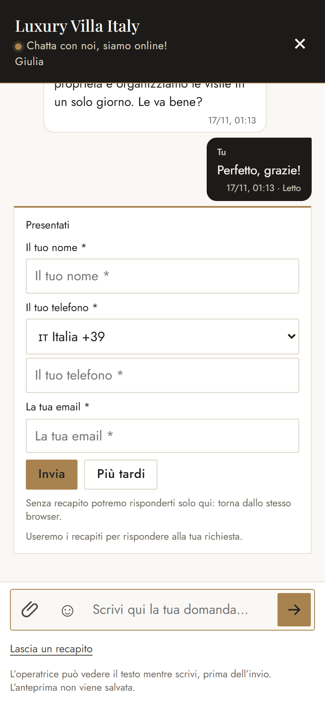
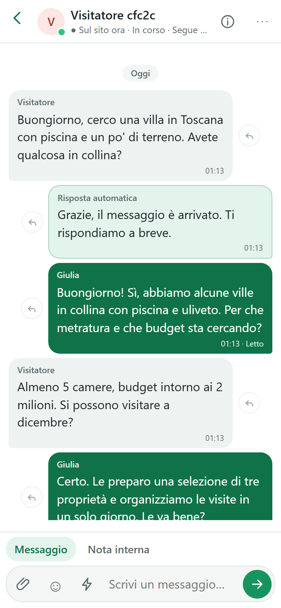
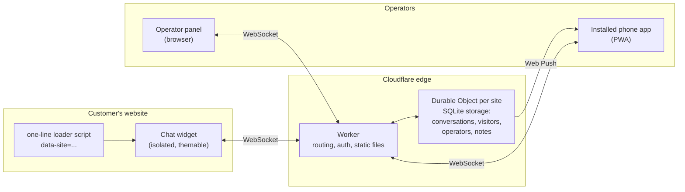

# Live chat for websites — built from scratch on Cloudflare (showcase)

> **Showcase only.** Screenshots and architecture of a customer-support chat I designed and shipped.
> The source code is private. All rights reserved.

A complete live-chat service for small businesses: a widget that any website loads with one line, an operator
panel in the browser, and an installable phone app with push notifications. It runs entirely on
**Cloudflare Workers + Durable Objects**, with no server to maintain. It is in production on
[Luxury Villa Italy](https://www.luxuryvillaitaly.com/), a luxury real-estate website, styled to match the site.

| Operator panel |
|---|
|  |

| On the phone: the site | The visitor's chat | Leaving contacts | The operator's app (PWA) |
|---|---|---|---|
|  |  |  |  |

*The conversation, the operator and the visitor are invented: the screenshots show the real site's page with the
widget connected to a local test server, so no real customer data appears and no message was sent to the live service.*

## Architecture

- **One Durable Object per website** holds the live state and an embedded **SQLite** database: conversations,
  messages, visitors, operators, internal notes. All WebSockets of a site meet in the same object, so delivery
  order and "who is answering" are consistent without an external database or queue.
- **WebSocket** for everything live (typing, messages, presence); reconnects and catches up after network drops.
- **Web Push** wakes the operator's phone when a new chat arrives, even with the app closed.
- **Loader script** with a versioned path, so a site keeps working while the widget evolves.

## Features

- Widget: proactive greeting, offline/"leave your contacts" form, attachments, several visual styles,
  per-language texts (Italian, English, Russian, Ukrainian).
- Operator panel: incoming queue, accept/transfer, conversations in progress, **internal notes** visible only to
  colleagues, visitor card (page, language, approximate location), canned replies.
- Phone app: installable PWA with push notifications and the same panel in a mobile layout.
- Several websites on one deployment, each with its own settings and operators.
- Automated end-to-end tests with Playwright (visitor + operator in the same run).

## Stack

Cloudflare Workers · Durable Objects (SQLite) · WebSocket · Web Push / VAPID · Service Worker / PWA ·
vanilla JavaScript · Playwright.

Built by directing AI coding agents (Claude Code, Codex) on a written spec, with automated browser tests as the
acceptance gate.

## Licence

© 2026 sas0208. **All rights reserved** — see [LICENSE](LICENSE).
